<picture><source media="(max-width: 1011px) and (prefers-color-scheme: dark)" srcset="assets/h-about-phone-dark.svg"><source media="(max-width: 1011px)" srcset="assets/h-about-phone-light.svg"><source media="(prefers-color-scheme: dark)" srcset="assets/h-about-dark.svg"></picture>

<picture><source media="(max-width: 1011px) and (prefers-color-scheme: dark)" srcset="assets/about-phone-dark.svg"><source media="(max-width: 1011px)" srcset="assets/about-phone-light.svg"><source media="(prefers-color-scheme: dark)" srcset="assets/about-dark.svg"></picture>

<picture><source media="(max-width: 1011px) and (prefers-color-scheme: dark)" srcset="assets/h-project-phone-dark.svg"><source media="(max-width: 1011px)" srcset="assets/h-project-phone-light.svg"><source media="(prefers-color-scheme: dark)" srcset="assets/h-project-dark.svg"></picture>

<a href="https://github.com/McDyZzz/idevice-control"><picture><source media="(max-width: 1011px) and (prefers-color-scheme: dark)" srcset="assets/card-idevice-control-phone-dark.svg"><source media="(max-width: 1011px)" srcset="assets/card-idevice-control-phone-light.svg"><source media="(prefers-color-scheme: dark)" srcset="assets/card-idevice-control-dark.svg"></picture></a><a href="https://github.com/McDyZzz/cc-session-breakdown"><picture><source media="(max-width: 1011px) and (prefers-color-scheme: dark)" srcset="assets/card-cc-session-breakdown-phone-dark.svg"><source media="(max-width: 1011px)" srcset="assets/card-cc-session-breakdown-phone-light.svg"><source media="(prefers-color-scheme: dark)" srcset="assets/card-cc-session-breakdown-dark.svg"></picture></a><picture><source media="(min-width: 1280px) and (prefers-color-scheme: dark)" srcset="assets/card-back-dark.svg"><source media="(min-width: 1280px)" srcset="assets/card-back-light.svg"></picture>

 

<picture><source media="(max-width: 1011px) and (prefers-color-scheme: dark)" srcset="assets/egg-summary-phone-dark.svg"><source media="(max-width: 1011px)" srcset="assets/egg-summary-phone-light.svg"><source media="(prefers-color-scheme: dark)" srcset="assets/egg-summary-dark.svg"></picture>

 
<picture><source media="(max-width: 1011px) and (prefers-color-scheme: dark)" srcset="assets/egg-reveal-phone-dark.svg"><source media="(max-width: 1011px)" srcset="assets/egg-reveal-phone-light.svg"><source media="(prefers-color-scheme: dark)" srcset="assets/egg-reveal-dark.svg"></picture>

